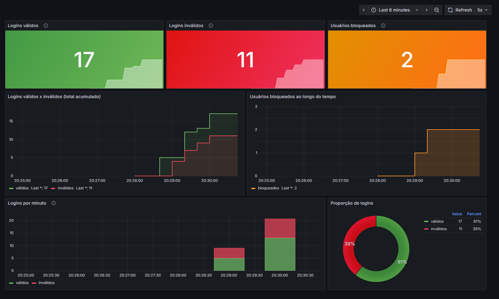

# MS-AV-02 - Segurança e Observabilidade

Mecanismo de login RESTful em **Spring Boot** com:

- **Segurança** com Spring Security: endpoints públicos e endpoints protegidos por *roles* usando `JdbcUserDetailsManager` + HTTP Basic
- **Bloqueio** do usuário quando ele falha no login mais de uma vez (tabela `login_attempts`)
- **Métricas** com Actuator + Micrometer: logins válidos, logins inválidos e usuários bloqueados
- **Dashboard no Grafana**, alimentado pelo Prometheus
- **Documentação OpenAPI** com interface Swagger



## Tecnologias

| Item | Versão |
| --- | --- |
| Java | 17+ |
| Spring Boot | 4.1.1 (web, security, data-jpa, jdbc, validation, actuator) |
| Banco de dados | H2 em memória |
| Documentação | springdoc-openapi 3.1.1 (Swagger UI) |
| Métricas | Micrometer + Prometheus 3.5 + Grafana 12.2 (via Docker) |

## Como executar

```bash
# Windows
mvnw.cmd spring-boot:run

# Linux / macOS / Git Bash
./mvnw spring-boot:run
```

A aplicação sobe em `http://localhost:8080`.

| Recurso | URL |
| --- | --- |
| Swagger UI | http://localhost:8080/swagger-ui/index.html |
| OpenAPI (JSON) | http://localhost:8080/v3/api-docs |
| OpenAPI (YAML) | http://localhost:8080/v3/api-docs.yaml |
| Métricas (Prometheus) | http://localhost:8080/actuator/prometheus |
| Health | http://localhost:8080/actuator/health |
| Console H2 | http://localhost:8080/h2-console (JDBC URL `jdbc:h2:mem:segurancadb`, usuário `sa`, senha `password`) |

## Usuários de teste

Existem dois tipos de usuário, carregados pelo [`data.sql`](src/main/resources/data.sql):

**Usuários do sistema** (tabela `usuarios`). São os que fazem `POST /login`:

| username | senha |
| --- | --- |
| joao | joao123 |
| maria | maria123 |
| pedro | pedro123 |

**Operadores** (tabelas `users` / `authorities` do `JdbcUserDetailsManager`). Acessam os endpoints protegidos via HTTP Basic:

| username | senha | role |
| --- | --- | --- |
| admin | admin123 | `ROLE_ADMIN` |
| manutencao | manut123 | `ROLE_MANUTENCAO` |

As senhas dos operadores estão gravadas com **BCrypt** (`{bcrypt}$2b$10$...`).

## Endpoints

| Método | Endpoint | Acesso | Corpo | Respostas |
| --- | --- | --- | --- | --- |
| POST | `/login` | público | `{"username": "", "senha": ""}` | 200 válido · 401 inválido ou bloqueado |
| PUT | `/trocarsenha/{userid}` | público | `{"atual": "", "nova": ""}` | 200 · 400 · 401 senha atual errada · 403 bloqueado · 404 |
| POST | `/` | `ROLE_MANUTENCAO` | `{"username": "", "senha": ""}` | 201 · 400 · 401 · 403 · 409 já existe |
| PUT | `/unlock/{userid}` | `ROLE_ADMIN` | - | 200 · 401 · 403 · 404 |
| GET | `/` | `ROLE_MANUTENCAO` | - | 200 (lista **sem** a senha) · 401 · 403 |

Nos endpoints protegidos, **401** significa que o operador não se autenticou (ou errou a senha) e **403** que ele não tem a *role* exigida.

### Regra de bloqueio

> "Caso o usuário falhe mais de uma vez no login ele deve ser bloqueado"

- Cada senha errada incrementa `failed_attempts` e grava `last_failed_at` em `login_attempts`
- Na **2ª falha consecutiva** o usuário fica `locked = true` (com `locked_at`). O limite é configurável em `login.tentativas-para-bloqueio`
- Usuário bloqueado recebe **401** no login, mesmo com a senha correta
- Um login válido (ou uma troca de senha válida) zera as falhas
- `PUT /unlock/{userid}` (admin) desbloqueia e zera as falhas
- A senha atual errada no `PUT /trocarsenha` também conta como falha. Sem isso, o endpoint público permitiria testar senhas sem nunca bloquear o usuário

### Exemplos com curl

```bash
# login válido (200) e inválido (401)
curl -i -X POST http://localhost:8080/login -H "Content-Type: application/json" -d '{"username":"joao","senha":"joao123"}'
curl -i -X POST http://localhost:8080/login -H "Content-Type: application/json" -d '{"username":"joao","senha":"errada"}'

# troca de senha (público)
curl -i -X PUT http://localhost:8080/trocarsenha/joao -H "Content-Type: application/json" -d '{"atual":"joao123","nova":"novo123"}'

# cadastrar e listar usuários (ROLE_MANUTENCAO)
curl -i -u manutencao:manut123 -X POST http://localhost:8080/ -H "Content-Type: application/json" -d '{"username":"ana","senha":"ana123"}'
curl -i -u manutencao:manut123 http://localhost:8080/

# desbloquear (ROLE_ADMIN)
curl -i -u admin:admin123 -X PUT http://localhost:8080/unlock/joao
```

## Documentação OpenAPI / Swagger

Os endpoints estão documentados com as anotações do springdoc (`@OpenAPIDefinition`, `@Operation`, `@ApiResponses`, `@Schema`, `@SecurityScheme`) em [`UsuarioController`](src/main/java/aula/microservicos/login/UsuarioController.java), [`OpenApiConfig`](src/main/java/aula/microservicos/login/OpenApiConfig.java) e nos DTOs do pacote `dto`.

No Swagger UI, use o botão **Authorize** com um operador (por exemplo `manutencao` / `manut123`) para testar os endpoints protegidos.

## Métricas

Definidas em [`LoginMetrica`](src/main/java/aula/microservicos/login/LoginMetrica.java) e expostas em `/actuator/prometheus`:

| Indicador | Micrometer | Prometheus | Tipo |
| --- | --- | --- | --- |
| Logins válidos | `login.validos` | `login_validos_total` | Counter |
| Logins inválidos | `login.invalidos` | `login_invalidos_total` | Counter |
| Usuários bloqueados | `usuarios.bloqueados` | `usuarios_bloqueados` | Gauge (conta `locked = true` em `login_attempts` a cada coleta) |

Todas as métricas têm a tag `application="av02-login"`.

## Prometheus + Grafana

A pasta [`observabilidade`](observabilidade) sobe o Prometheus e o Grafana com Docker. O datasource e o dashboard já são carregados automaticamente (*provisioning*).

```bash
# 1. subir a aplicação (porta 8080)
./mvnw spring-boot:run

# 2. subir Prometheus e Grafana
cd observabilidade
docker compose up -d

# 3. (opcional) gerar logins válidos, inválidos e bloqueios para o dashboard
cd ..
./scripts/simular-logins.sh
```

| Serviço | URL |
| --- | --- |
| Prometheus | http://localhost:9090 (alvo `host.docker.internal:8080/actuator/prometheus`) |
| Grafana | http://localhost:3000 (`admin` / `admin`), dashboard **MS-AV-02 - Login** |

Se a porta 3000 estiver ocupada: `GRAFANA_PORT=3001 docker compose up -d`.

### Dashboard

- **Export do dashboard (JSON)**: [`observabilidade/grafana/dashboards/av02-login-dashboard.json`](observabilidade/grafana/dashboards/av02-login-dashboard.json). Para importar em outro Grafana: *Dashboards > New > Import*
- **Print**: [`img/dashboard-grafana.png`](img/dashboard-grafana.png)

Painéis:

| Painel | PromQL |
| --- | --- |
| Logins válidos | `sum(login_validos_total{application="av02-login"})` |
| Logins inválidos | `sum(login_invalidos_total{application="av02-login"})` |
| Usuários bloqueados | `sum(usuarios_bloqueados{application="av02-login"})` |
| Válidos x inválidos (acumulado) | os dois contadores ao longo do tempo |
| Bloqueados ao longo do tempo | `usuarios_bloqueados` |
| Logins por minuto | `sum(increase(login_validos_total[1m]))` e `sum(increase(login_invalidos_total[1m]))` |
| Proporção de logins | válidos x inválidos (pizza) |

## Testes

```bash
./mvnw test
```

[`LoginApplicationTests`](src/test/java/aula/microservicos/login/LoginApplicationTests.java) sobe a aplicação numa porta aleatória e testa via HTTP: login 200/401, bloqueio na 2ª falha, zerar falhas no login válido, roles (401/403) nos endpoints protegidos, cadastro (201/409/400), listagem sem senha, troca de senha, métricas no `/actuator/prometheus` e a documentação OpenAPI.

## Estrutura

```
src/main/java/aula/microservicos/login
├── LoginApplication.java
├── SecurityConfig.java          # regras de acesso, JdbcUserDetailsManager, PasswordEncoder
├── OpenApiConfig.java           # @OpenAPIDefinition e esquema de segurança basicAuth
├── UsuarioController.java       # endpoints + anotações OpenAPI
├── UsuarioService.java          # login, bloqueio, troca de senha, cadastro, desbloqueio
├── LoginMetrica.java            # counters e gauge do Micrometer
├── Usuario.java / LoginAttempt.java                  # entidades (usuarios / login_attempts)
├── UsuarioRepository.java / LoginAttemptRepository.java
├── ResultadoLogin.java, UsuarioException.java, TratamentoErros.java
└── dto/                         # LoginRequest, NovoUsuarioRequest, TrocaSenhaRequest, UsuarioResponse, Mensagem
src/main/resources
├── application.properties
├── schema.sql                   # tabelas do enunciado + users/authorities
└── data.sql                     # usuários e operadores de teste
observabilidade/                 # docker-compose, prometheus.yml e provisioning do Grafana
scripts/simular-logins.sh        # gera tráfego para o dashboard
```

## Observações

- O script SQL do enunciado tinha uma vírgula sobrando depois de `updated_at` em `login_attempts`, o que impedia a criação da tabela. Ela foi removida em [`schema.sql`](src/main/resources/schema.sql).
- A tabela `usuarios` do enunciado define `senha VARCHAR(10)`, que não comporta um hash BCrypt (60 caracteres). Por isso as senhas dos usuários do sistema ficam em texto puro e a nova senha é limitada a 10 caracteres. As senhas dos operadores (`users`) usam BCrypt.
- O banco é H2 em memória: ao reiniciar a aplicação, os dados e os contadores voltam ao estado inicial.
- O Grafana do `docker-compose` permite acesso anônimo somente leitura, para facilitar a visualização em ambiente local.
